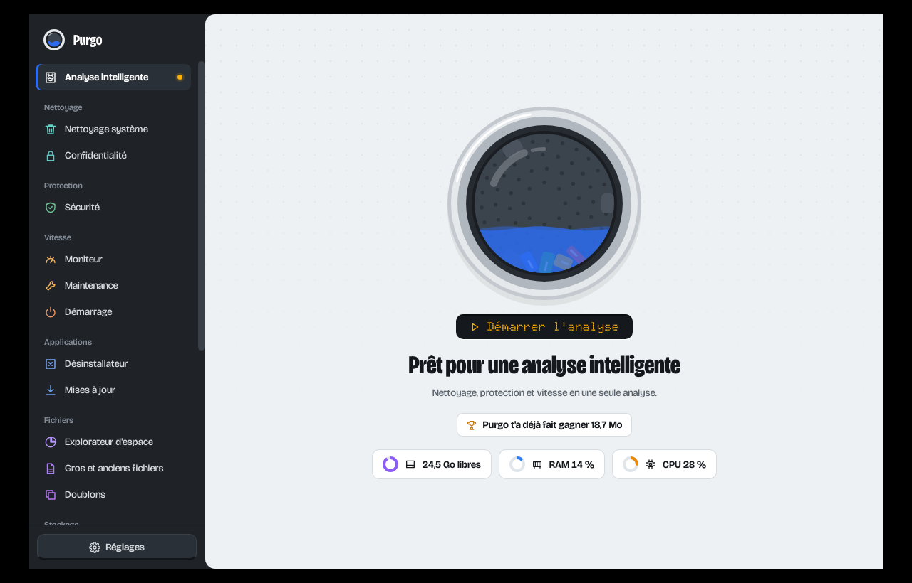
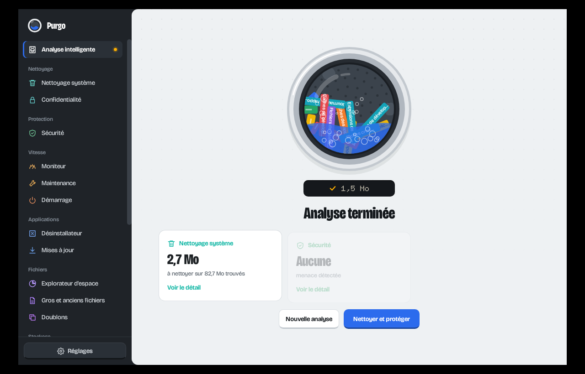
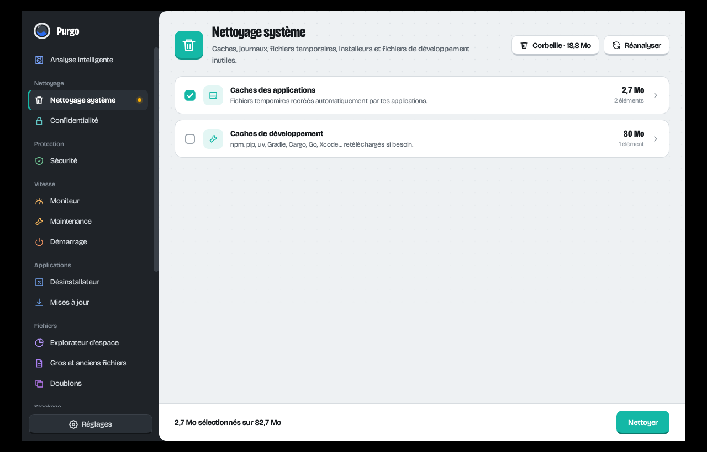

# Purgo

Purgo nettoie, protège et accélère ton ordinateur, sous **Windows, Linux et macOS**.
Il fait aussi le ménage dans tes outils de développement : environnements Python, `node_modules`, Docker, dépôts Git et modèles d'IA.



Tout ce que Purgo supprime part dans la **Corbeille**. La seule action définitive est « Vider la Corbeille », et elle demande confirmation.

## Télécharger

Les installeurs sont compilés automatiquement à chaque version, dans l'onglet [Releases](../../releases) :

| Système | Fichier |
| --- | --- |
| Windows 10 / 11 | `.msi` ou `-setup.exe` |
| macOS (Apple Silicon et Intel) | `.dmg` |
| Linux | `.deb` (Ubuntu, Debian, Mint), `.rpm` (Fedora, openSUSE) ou `.AppImage` (toutes distributions) |

Les versions de développement sont aussi disponibles comme artefacts dans l'onglet [Actions](../../actions).

> L'app n'est pas signée par un certificat payant. Au premier lancement, Windows SmartScreen peut demander « Exécuter quand même » ; sur macOS, fais un clic droit sur l'app › Ouvrir.

## Ce que fait Purgo

**Analyse intelligente** : un clic lance le nettoyage, la sécurité et le démarrage, puis « Nettoyer et protéger ».



| Section | Modules |
| --- | --- |
| Nettoyage | Fichiers inutiles (caches, journaux, temporaires, installeurs, Windows.old, caches de développement), confidentialité (Chrome, Edge, Brave, Firefox, Opera, Vivaldi, Safari et traces du système) |
| Protection | Adwares connus, démarrages et tâches planifiées suspects, extensions malveillantes, scripts de shell suspects, état de Microsoft Defender / XProtect / ClamAV |
| Vitesse | Moniteur en temps réel (CPU, RAM, disque, batterie, apps gourmandes), maintenance propre à chaque système, éléments de démarrage |
| Applications | Désinstallateur avec les fichiers résiduels (registre Windows et Microsoft Store, Flatpak, Snap, APT/DNF/pacman, AppImage, apps macOS), mises à jour et ménage de winget, Scoop, Chocolatey, APT, DNF, pacman, Flatpak, Snap, Homebrew, npm, pipx |
| Fichiers | Explorateur d'espace, gros et anciens fichiers, doublons (SHA-256) |
| Stockage | Copies locales OneDrive / iCloud Drive, rangement de Téléchargements et du Bureau (annulable), projets Ableton Live et sauvegardes FL Studio, conseils de réglages propres à chaque système |
| Développeurs | Python (venv, Conda, Poetry, pipx, pyenv, uv, interpréteurs, paquets en double, caches), Node.js, Docker, dépôts Git (non poussés, abandonnés), modèles d'IA (Ollama, Hugging Face, LM Studio, Whisper…) |

**En arrière-plan**, tant que Purgo tourne dans la zone de notification, il peut :
- prévenir quand le disque passe sous un seuil ;
- prévenir quand une version de Python disparaît après une mise à jour ;
- nettoyer les caches chaque semaine (désactivé par défaut) ;
- se lancer au démarrage.



## Compiler soi-même

Prérequis : [Rust](https://rustup.rs), Node.js 18+, et sous Linux les bibliothèques WebKitGTK :

```bash
# Ubuntu / Debian
sudo apt install libwebkit2gtk-4.1-dev libayatana-appindicator3-dev librsvg2-dev libxdo-dev
```

Puis :

```bash
npm install
npm run dev      # lance l'app en mode développement
npm run build    # produit les installeurs dans src-tauri/target/release/bundle
```

## Structure

```
ui/              interface (HTML, CSS, JavaScript sans framework)
  js/drum.js     le hublot animé (canvas) : tambour, eau, fichiers qui culbutent
  js/m-*.js      les modules
src-tauri/src/   cœur en Rust, un fichier par domaine
  util.rs        chemins, tailles, Corbeille, droits administrateur pour chaque OS
  junk.rs, privacy.rs, security.rs, monitor.rs, maintenance.rs, startup.rs,
  apps.rs, packages.rs, files.rs, python.rs, dev.rs, storage.rs, settings.rs
macos-native/    première version de Purgo, en SwiftUI, réservée à macOS
```

Polices : [Bricolage Grotesque](https://github.com/ateliertriay/bricolage) et [Doto](https://github.com/oliverlalan/Doto), sous licence SIL Open Font License (voir `ui/fonts`).
